# 📋 SAM BOND — Attendance App

An Android attendance app for **SAM BOND**: selfie + live GPS check-in, late-arrival detection, leave requests with yearly balances, overnight **Night Hold** reporting, and a multi-level manager hierarchy with approvals — all backed by a **Google Sheet**. No server or database to run, and APKs are built automatically by **GitHub Actions**.

> Android 7.0+ · Kotlin · Google Apps Script backend · Pay period **26th → 25th** · Timezone **Asia/Dhaka**

---

## 📸 Screenshots

Real screens from the app (Dark theme; Light uses the same layout on butter and cream). The brand name, logo and people's names are blurred.

**Getting in**

<table><tr>
<td align="center">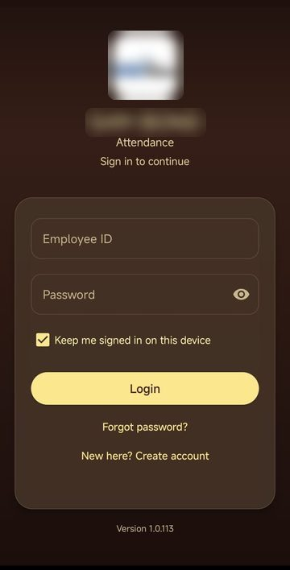<br><sub>Sign in</sub></td>
<td align="center">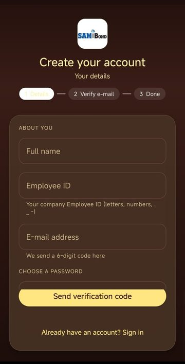<br><sub>Create account</sub></td>
<td align="center">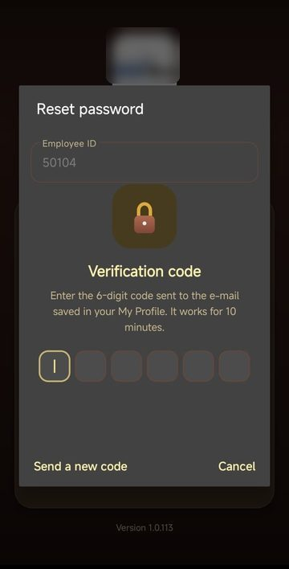<br><sub>Verification code</sub></td>
</tr></table>

**Every day**

<table><tr>
<td align="center">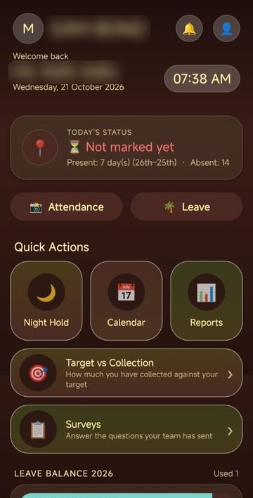<br><sub>Home</sub></td>
<td align="center">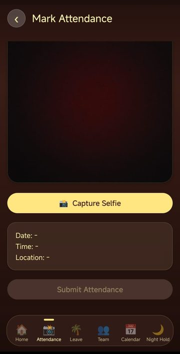<br><sub>Attendance</sub></td>
<td align="center">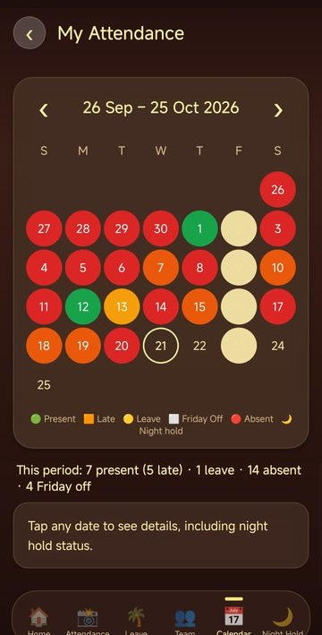<br><sub>Calendar</sub></td>
<td align="center">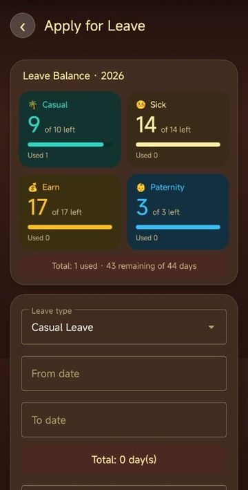<br><sub>Leave</sub></td>
</tr></table>

<table><tr>
<td align="center">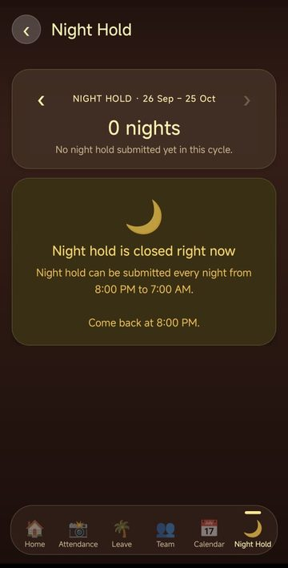<br><sub>Night Hold</sub></td>
<td align="center">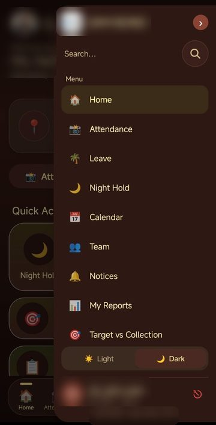<br><sub>Side menu</sub></td>
<td align="center">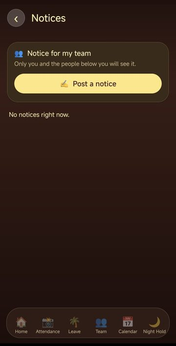<br><sub>Notices</sub></td>
</tr></table>

**Managers and admins**

<table><tr>
<td align="center">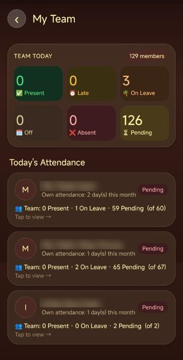<br><sub>My Team</sub></td>
<td align="center">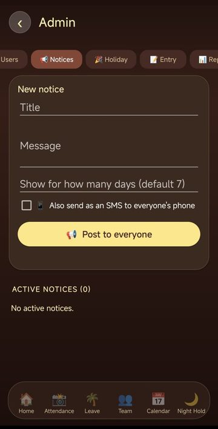<br><sub>Admin: Notices</sub></td>
<td align="center">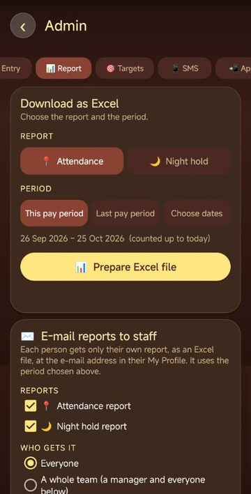<br><sub>Admin: Report</sub></td>
<td align="center">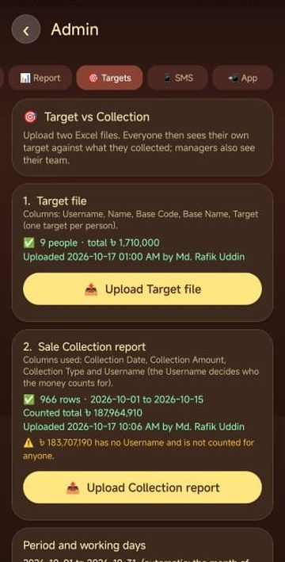<br><sub>Admin: Targets</sub></td>
</tr></table>

<table><tr>
<td align="center">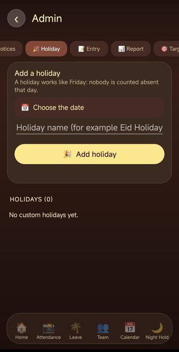<br><sub>Admin: Holiday</sub></td>
<td align="center">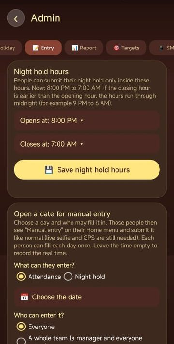<br><sub>Admin: Entry</sub></td>
<td align="center">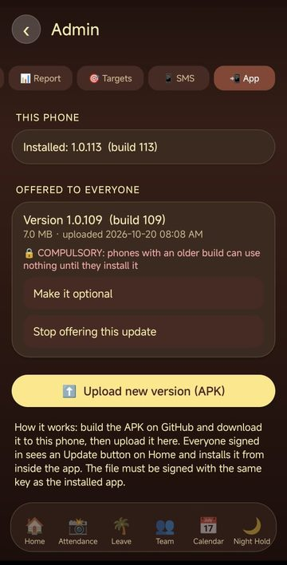<br><sub>Admin: App</sub></td>
</tr></table>

---

## ✨ Features

### For every employee
- **Login / Logout / Change password** — Employee IDs (the sign-in name) live in a Google Sheet and passwords are stored there only as salted hashes. The app never keeps the password: it signs in once and uses an expiring token. Staff change their own password in the app (current password required, at least 8 characters). Five wrong passwords pause an account for 15 minutes. The login screen has **Keep me signed in on this device** (ticked by default): ticked, you stay signed in for 30 days and the sign-in renews itself every time you use the app; unticked, the sign-in ends after 12 hours (use this on a shared phone).
- **Attendance reminders in the notification bar** — from **8:30 AM** until 6:00 PM on working days, a person who has not marked attendance gets a phone notification (*Mark your attendance*, and from 9:10 AM *You have not marked attendance*); tapping it opens the attendance screen. It disappears once attendance is marked, and never appears on Friday, on a holiday, or during approved leave. **Managers** also get *👥 N team members not marked yet* with the names (from 9:10 AM, so nobody is chased during the grace period). At most one reminder of each kind per hour. Switch them off in the 👤 menu (*Attendance reminders*). Android 13+ asks for notification permission the first time. These are **checked by the phone about every 30 minutes** (Android picks the exact moment to save battery) — they are not instant push messages, and phones with an aggressive battery saver (Xiaomi, Oppo, Vivo, some Samsung) may delay them: set the app's battery use to *Unrestricted*. Real instant push would need Firebase.
- **📝 Late reason** — right after a late attendance is submitted, a **compulsory pop-up** asks *Why were you late?* — it cannot be closed (no Cancel, Back does nothing) until a reason of 3–200 characters is saved; if the app is closed first, the pop-up comes back on Home / Attendance until today's reason is saved. Also, when today's attendance is *⏰ Late Present*, a line **📝 Add late reason** appears right under the status (Home and Attendance), to change the text later the same day. Tap it, write why (3–200 characters) and save; tap again the same day to change it. Line managers see it on the person's card in **Team** (*📝 No late reason yet* if empty); managers and admins see it in the person's calendar day. Stored on the **LateReasons** tab (Date, Username, Name, Reason, SavedAt; created on first use). Locking *Attendance* for a person also locks this.
- **Selfie attendance** — front-camera selfie (required, JPEG only, size-limited), live GPS location (fake/mock GPS is rejected), address lookup, and a **server-side** date/time stamp (changing the phone's clock does nothing).
- **Fast, reliable GPS** — one shared helper (`LiveLocation.kt`) keeps listening for a live fix instead of one try that can come back empty on a cold start; it shows the seconds while searching, tells you if the phone's Location switch is off, accepts a rougher fix after 10 seconds indoors, and gives a clear message after 45 seconds.
- **Location is required** — a submission without a real GPS location, or with one outside Bangladesh, is rejected by the server, not just the app.
- **Late Present** — there is a **10-minute grace period**: submitting up to 9:09 AM is on time, and at or after **9:10 AM** is marked *⏰ Late Present* with the time.
- **Absent** — still unmarked after **6:00 PM** counts as *Absent*; past unmarked days show as Absent too. **Friday is an automatic weekly off**, and so is any **custom holiday** an admin adds; neither is ever counted as absent.
- **Today's selfie on Home** — once you've checked in, the *Today's Status* circle shows your selfie as a small round picture (tap it to see it bigger) with where it was taken underneath.
- **One check-in per day** — a second submission on the same day is blocked.
- **Leave requests** — Casual, Sick, Earn or Paternity leave with a from/to date picker; days are counted automatically.
- **Leave application picture + reason (both required)** — attach a photo of your signed leave application (📷 *Take photo* or 🖼 *Choose picture*) **and** write a reason (3+ characters). A request can't be sent without both; the server refuses it too. The picture is shrunk on the phone and stored privately in the Drive folder with the selfies; you, your manager and every supervisor above you can open it from the leave request (*📎 View leave application*).
- **🔍 Only a leave application is accepted** — after you attach the picture, the phone **reads it** (Google ML Kit text recognition through Google Play services; the model is not inside the APK and nothing is sent anywhere for it) and checks that it looks like a leave application: enough readable words, one of *leave / application / apply / subject* and the usual letter words (*sir, madam, dear, respectfully, kindly, request, grant, sick, casual, signature …*). A selfie, screenshot, receipt or any other picture is refused with *This does not look like a leave application*, and the **Apply for Leave button stays hidden** until a picture has passed (*✅ Leave application checked*). Limits: it reads **English (Latin) text only** and handwriting is read less well than print, so ask people to photograph the whole page flat, in good light and in focus; it is a check, not a proof. If a phone cannot run the check it accepts the picture. **Switch it off for everybody** with the Script Property `LEAVE_ATTACHMENT_CHECK` = `off` (phones pick it up the next time the Leave screen loads; delete the property to switch it on again). Files: `LeaveCheck.kt`, `LeaveActivity.kt`.
- **👁 Live check before the selfie** — on the Attendance screen the **📸 Capture Selfie button is hidden** until the camera has seen a real, live face do **two random quick things** (blink, turn the head to one side, smile). It runs on the phone with ML Kit from Google Play services (no picture leaves the phone for it) and keeps watching until the selfie is taken. If a phone cannot run it, attendance carries on without it. **An admin can switch it on or off** in *Admin Panel → Entry → Live check before the selfie* (asks for the admin's own password; stored in the Script Property `LIVE_CHECK`, `off` = off); phones pick the change up the next time they open Attendance. It stops casual cheating (holding up a photo); it is not proof against a modified app.
- **🚗 Drivers: car meter picture** — a person with the **Driver** right (*Admin Panel → Users → 🔐 Menu access → EXTRA RIGHTS → 🚗 Driver*, stored as `+driver` in Users column K) **or with the word `driver` in the Role cell of the Users sheet** (column F; spaces and capitals do not matter; the Admin Panel then shows *🚗 Driver (Role column)* and the tick cannot be changed there) takes **two pictures** on the Attendance screen: the **selfie** (front camera, live check as usual) and then a **picture of the car meter** with the **back camera** (tap the picture to focus; 🔦 switches the light on). The phone **reads the km number** in the meter picture (the same Google ML Kit text recognition as the leave-application check; the model is not inside the APK and nothing is sent anywhere for it): a number of **4 to 9 digits**, with a second look at a grey, higher-contrast copy if the first look finds none. **The Submit Attendance button stays hidden until the picture is verified** (*✅ Car meter verified · 123456 km*); no number found shows *❌ No km number could be read* and a **Retake car meter** button, and retaking hides Submit again. If the phone cannot run the reader at all, or it does not answer within 25 seconds, the picture is accepted without a number. The **server refuses a driver's attendance without a meter picture** (an old app cannot skip the step: *You are a driver: please take a picture of the car meter …*) and refuses a picture that is not a JPEG or is too big. The picture (1280 px JPEG) goes to the same private Drive folder as selfies; its file id is in **Attendance column K (Meter)** and the km read in **column L (MeterKm)** (both added by the first driver's attendance). It shows as **🚗 Car meter · 123456 km · tap to see the picture** on the driver's own status card and on the driver's card in **Team** for every line manager above (the same rule as selfies; nobody else can open it). **Switch the number check off** in *Admin Panel → Entry → 🚗 Car meter check* (asks for the admin's own password; Script Property `METER_CHECK` = `off`): the picture is then still required but any picture is enough, for meters a phone cannot read (old dials with rolling digits). It is a check, not a proof: any picture with a number of 4+ digits passes. Files: `MeterCheck.kt`, `AttendanceActivity.kt`, `activity_attendance.xml`, `AdminActivity.kt`, `TeamActivity.kt`.
- **🏁 Drivers: day end** — at the end of the work day a driver (same two ways to be a driver as above) sends a **Day End**: once today's attendance is marked, the Attendance screen shows the **🏁 Day end** card (the same card as the morning meter step). The driver taps **📷 Start Day End**, the **back camera** opens, a **new picture of the car meter** is taken, and the phone reads the km number with the same check as in the morning (4 to 9 digits, a second look at a grey high-contrast copy, accepted when the reader cannot run or does not answer in 25 seconds; the admin's number-check switch covers it too). Under the picture the phone says how many km the car went **since the morning picture**, or warns when the new number is lower. **The Submit Day End button stays hidden until the picture is verified.** No selfie and no location are taken at the day end. Server action `dayEnd` (locked together with the Attendance menu): drivers only, needs **today's** attendance row (server clock, so a day end after midnight has no row to join), a valid JPEG, once a day (*Day end already submitted today*), and the picture is thrown away again whenever the request is refused. It is written into the driver's own Attendance row: **column M = DayEndTime, N = DayEndMeter** (Drive file id, 1280 px JPEG in the same private folder), **O = DayEndKm** (plain text; headers added by the first day end). The **km driven** (O − L) is never stored; it is worked out whenever it is shown (`kmDriven`: −1 on the wire when either number is missing or the day end number is lower), so a km corrected by hand in the sheet is picked up. It shows as **🏁 Day end · 05:31:02 PM · 045678 km · 468 km driven · tap to see the picture** on the driver's status card (Attendance), on Home (with *Day end not sent yet: Mark Attendance > Start Day End* as a reminder until it is sent) and on the driver's card in **Team** for every line manager above (*🏁 Day end · not yet* until then); the picture follows the same viewing rule as selfies (the person and the supervisors above; `photo` also looks in column N). Old phones have no Day End step. Files: `AttendanceActivity.kt`, `activity_attendance.xml`, `MainActivity.kt`, `TeamActivity.kt`, `AdminActivity.kt` (texts), `Code.gs` (`dayEnd`, `kmDriven`, `history`, `team`, `findAttendanceOwnerByFile`).
- **🌙 Team night hold summary** — on the Team screen, under the Team Today numbers: the **total night holds** of the latest night (*37 of 130*), and **team by team** (*submitted of total* for each direct report who has a team, and one *Direct reports* group, so the groups add up to the total). Tap the total or a team to list **name, hotel, thana / district, date and time** (tap a row for the map; search by name, ID or place). The date chip opens any earlier night, and the **Previous / Current / Next** chips show a whole pay cycle (26th→25th: night holds, people, team by team, newest first). Server action `teamNight` (`nightDate` or `cycle`: `prev`/`current`/`next`).
- **🙂 Face check (flag only)** — when the face-recognition model file is in the app (`app/src/main/assets/face_model.tflite`, a MobileFaceNet), the phone turns each selfie into a short **face print** (numbers only; ML Kit finds the face, the model runs through Google Play services, so the APK stays small) and sends just those numbers with the attendance. The first selfies (up to 3) become the person's **reference**, kept in the **FaceRefs** sheet so it survives a phone change; later selfies are compared with it. A weak match **never blocks** attendance: the Attendance sheet's **Face** column says *Enrolled*, *Match 78*, *Mismatch 31* or *No face*, and line managers (Team, Calendar) and admins (Calendar) see a ⚠️ note. The app shows the person no message about it (tell your staff yourself). Admin Panel → Users → **🙂 Reset face** clears a reference (needs your password). Without the model file nothing changes.
- **Leave balance** — by default **Casual 10 · Sick 14 · Earn 17 · Paternity 3** days per year (an admin can change them in *Admin Panel → 🌴 Leave*), with *left of total · used* shown per type. (The app has no gender field, so every employee gets the Paternity balance.)
- **Attendance ↔ leave conflict checks** — you can't mark attendance on an approved-leave day, or apply for leave on a day you already marked present.
- **Night Hold** — staying away overnight? Report it with:
  - live GPS (fake/mock locations are rejected),
  - **district → thana** pickers (all **64 districts**, with searchable lists),
  - **hotel name**,
  - a **summary at the top of the screen** for the current cycle (26th → 25th): the number of night holds and the last one, with **‹ ›** arrows to look at previous cycles; the **details below the form**: for each night the date/time, hotel, thana and district (tap one to open its location in Maps).
  - **only during the night-hold hours** (9:00 PM to 6:00 AM unless an admin changed them in *Admin Panel → 📝 Entry*) — outside those hours the Night Hold screen shows a *closed* notice and the server refuses a submission. It is **one per night**: a night is named by the date its evening started, so a 2:00 AM submission counts for the night before. The form can't be submitted without real data (checked again on the server).
- **Colours: Clay Brown + Soft Butter** — Clay `#6B352A` (header, buttons, text) and Butter `#FFF1A6` (chips, tiles, highlights) on a cream page; Dark mode is butter text on deep clay. To change the look, edit `res/values/colors.xml` (day), `res/values-night/colors.xml` (night) and the `NIGHT` table in `Theme.kt`. Red/green/amber status colours are unchanged.
- **Accent colours and screen effects** — the side menu has a 🎨 row of colour dots (Clay = the original, Forest, Ocean, Violet, Rose, Slate); the choice is kept on the phone and re-tints the whole app (code colours through `Pal.c`, XML colours through `Fx.kt`, which re-tints the brand colours of every screen as it opens; status colours are never changed). `Fx.kt` also adds the pop-in bounce for cards, the press squeeze, the count-up for big numbers and a soft accent shadow for flat cards; each step skips itself on any surprise. Team has a **Team members** hero card. No server change.
- **Design pass (readability, pop-ups, tap sizes)** — the palest text browns were too faint (3.3 : 1 and 2.8 : 1 against the cream); they are now darker (4.9 : 1 and 3.3 : 1), and every accent keeps exactly the contrast Clay has because a tinted colour keeps its *lightness* and only its hue moves (`Pal.tint`). The **Calendar** day colours are easier to tell apart and a **key** under the grid names each one (Present, Late, Leave, Holiday, Friday off, Absent, 🌙 Night hold). Home's header text sits on a soft shade (`bg_header_home.xml`) so it stays readable over the picture; the Leave progress bars are darker in Dark mode (`drawable-night/bar_*.xml`); emoji that older phones show as an empty box were replaced (🪪→📇, 🧭→🗂, 🧾→📄). The bottom bar's labels shrink to fit instead of wrapping (a 🔒 adds width), and the small round buttons are 44 dp (header back / refresh, Home bell and menu); the Admin tabs, the side-menu fold button and the Night Hold date button are bigger too. **Pop-up dialogs** now share one soft rounded card in the app's colours with accent-coloured buttons: `Theme.Sam.Dialog` (system dialogs, with a Night twin in `values-night/themes.xml`) and `Theme.Sam.AppDialog` (AppCompat dialogs) in `themes.xml`, wired through `alertDialogTheme`; pictures in pop-ups sit inside a margin with rounded corners (`pictureFrame` in `Photos.kt`). The accent reaches dialogs, switches and text buttons through a theme overlay per accent (`values/overlays.xml` and `values-night/overlays.xml`, generated with the same maths as `Pal.tint`) that `Fx.kt` applies to a screen before its layout is made; `colorPrimary` / `colorSecondary` read the accent-aware attributes in `attrs.xml`. No server change.
- **Side menu and Day / Night colours** — the **👤** button on Home opens a side panel from the right edge (search, all menus with the unread-notice count, settings, a **☀️ Light / 🌙 Dark** switch, your name with **Log out**; the **›** button folds it into an icon strip). Light/Dark restyles the whole app and is kept per phone. Colours: `res/values/colors.xml` (day) and `res/values-night/colors.xml` (night) for the layouts, `Theme.kt` (`Pal`) for colours written in the screens, `SideMenu.kt` for the panel.
- **Labelled password fields and "Seek" search** — every password box (sign-in, create account, forgot / change password, and the admin "your own password" confirmations) is a *labelled field*: the label sits in the field as its placeholder, lifts into the top edge on focus while the outline parts around it, with soft 14 dp corners, an outline that turns accent-coloured, and a show/hide eye. Every search box (side menu, Admin → Users, My Team, the pick-one lists and the multi-pick list) is a *Seek* search: a search icon that becomes the field as one object — tap it and the field opens leftwards around the magnifier, the placeholder moves inside, **✕** clears, and an empty field folds back into the icon (lists inside pop-ups open by themselves). Code: `Fields.kt` (`FloatField`, `SeekField`), style `Widget.Sam.Field` in `themes.xml`, colours `field_line` / `field_focus` (Day and Night).
- **My Reports** — open **👤 menu → 📊 My Reports** to download your own **Attendance** and/or **Night hold** report as an Excel file (tap one or both; with both you get two files) (this pay period, last pay period or any dates, up to a year). A manager gets a *Whose report* choice: **👤 Only me** or **👥 My team** (their own report plus everyone below them in the chain). The server decides whose data you may have; nobody can get a report for someone outside their own line. Admins can still download everyone's in the Admin Panel.
- **🎯 Target vs Collection** — Home tile / 👤 menu: your target, what you collected, what remains and the %, with a day-by-day view. **Managers** also see their whole team (total + each person), **admins** see everyone. The top of the screen shows the **working days of the month: passed, remaining and total** (Fridays and the admin's holidays are not working days), and every person and the team total show the **RR = (target − collection) ÷ remaining working days**. The numbers come from the files an admin uploads (Admin Panel → 🎯 Targets).
- **📋 Surveys** — Home tile / 👤 menu: the questions your admin has sent. Open one, answer, **Submit** (once only; you can look at your answers afterwards). New ones show a badge. Questions can be short answer, paragraph, single choice, multiple choice, dropdown, rating (5 or 10), Yes/No, number, date or **📎 attachment (a picture from the camera or gallery)**. A survey can carry a picture from the admin, a deadline and an *Anonymous* mark (your name is then not saved with your answers).
- **⬇️ Downloads** — 👤 menu → ⬇️ Downloads: the PDF files your admin uploaded (price lists, policies, forms…). Each card shows the title, a short description, file name, size and date. **👁 View** opens it in the phone's PDF viewer; **⬇ Download** asks where to save it (the file is fetched in pieces with a percentage, and kept on the phone for next time). Admins also see **➕ Upload a PDF** (pick a PDF up to 15 MB, give a title and a description; needs the admin's own password) and **✏️ Edit** on every card: change the title / description, **hide** it from staff (unticked = hidden, the card shows *Hidden*) or **delete** it for everyone. Files are kept in the private Drive folder *DownloadFiles* in 512 KB pieces and listed on the **Downloads** tab (ID, Title, Description, FileName, Size, Chunks, PieceIds, UploadedBy, UploadedOn, Active); up to 200 files. Menu access key `downloads` (can be locked per person).
- **🛒 Orders** — 👤 menu → 🛒 Orders. **➕ New order**: pick one of *your* customers (the admin gives each customer to one person), add products with quantities; the price, the **trade-offer free items** and the total are worked out by the server and shown live. Send it: it goes to your **line manager** (a person with no active manager goes straight to the admin) → **admin final approval** → **Accounts** (enters the received amount) → **Delivery** (*Ready to Ship → Shipped → Delivered*, one step at a time). *My orders* shows the latest status and a history of every step; you can **cancel** until the admin approves. From *Pending Accounts* on, every order has an **📄 Invoice** and a **🚚 Challan** (PDF made by the server: view, save or share; the challan has quantities only). After delivery you can **↩ Return products** (per product, up to what was delivered, free items included, with a reason); the admin or delivery person approves/rejects it and marks it received. Nobody can approve their own order.
- **Attendance screen** — the **TODAY'S STATUS** card from Home (status, present/absent for the 26th–25th, selfie, address and coordinates) is shown at the top. Once today is **Present / Late Present or Absent**, the camera, **Capture Selfie**, the live date/time/location box and **Submit Attendance** are hidden (only the status card stays); they show again while attendance can still be marked (not marked yet, leave/holiday/Friday keep the old behaviour). A day an admin opened for manual entry always shows the form. The result pop-up (✅ submitted / ⏰ Late / ℹ️ Already submitted) closes by itself after 5 seconds, or earlier with OK.
- **Manual entry list** — the side menu shows **Manual entry (N)** with every day an admin opened for you (newest day first, up to 120; a day you already filled in is not listed again).
- **Notices** — a notice from an admin (for everyone) or from **your manager (team notice)** appears as a card on Home, behind a 🔔 **bell** at the top (a red number shows how many you haven't opened), and as a **pop-up on Home every time you sign in** or open the app fresh. *Got it* closes it; *View all notices* opens the list.
- **Update from inside the app** — when an admin publishes a newer version, a blue **⬆️ Update available** card appears on Home (and an *Update app* item in the 👤 menu). Tap **Update**, the app downloads the new version (with a progress bar), checks it isn't damaged, and opens Android's installer. The first time, Android asks you to allow *Install from this source* for this app. Your data is not affected.
- **My Profile** — open it from the round photo at the top-left of Home, or from the 👤 menu → *My Profile*. You can:
  - **change your profile photo** (📷 *Take photo* or 🖼 *Choose picture*) — this is separate from your daily attendance selfie, and it replaces the letter in the round avatar on Home;
  - keep your **official phone**, **personal phone** and **email address**;
  - set an **emergency contact**: phone number plus **relation** from a drop-down (*Wife, Son, Brother, Mother, Father, Daughter, Other*). Choose **Other** and a box appears where you write the relation yourself;
  - choose your **Base Name** from a searchable list — the **Base Code** fills in by itself (a name used by several bases shows its code in the list) — and your **T-shirt size** (S, M, L, XL, XXL, 2XL).
  - add your **bike number**, and — **for managers only** — your **laptop model**.
  - The base list is the **Bases** tab of the Sheet (BaseCode, BaseName; made automatically with the 161 bases). Edit that tab to add, rename or remove bases. Saved in the Profiles tab columns K–M (BaseName, BaseCode, TShirt).
  
  Every field is optional (an emergency phone and its relation go together). Phone numbers are checked (digits, 8–15, optional `+`) and email addresses too. Only you can change your own profile.
- **Calendar** — the pay period (26th–25th) at a glance: present, late, leave, Friday off, 🎉 holidays, absent, and 🌙 night-hold days. Tap any date for details, including that day's night-hold status.

### For managers
- **Team notices** — on the Notices screen a manager has **✍️ Post a notice**: a title, a message and how many days to show it. It is visible to **that manager and everyone below them** only (not to their own boss or other teams), and only the manager who wrote it can remove it. Ordinary staff cannot post. Admins still post notices for everyone from the Admin Panel.
- **Team reports** — *My Reports → 👥 My team* downloads an Excel report for the manager and everyone below them.
- **Night hold report layout** — the Night hold Excel follows the Samuda sample: company name, *DSM/ZM & RSM/ASM Night Hold Report* and the period as titles, then per person three rows (*Date / Night Hold Location / Night Hold Qty*, one column per night) with **Total** (number of nights; people with no night hold in the period are left out). *Desig* is the person's **Designation** (see below). Optional Script Properties: `COMPANY_NAME`, `NIGHT_REPORT_TITLE`. A second sheet *Night Holds* keeps every record with hotel, thana, district and coordinates.
- **Designation** — a profile field with a fixed list: Sales Officer, Territory Sales Officer, Zonal Manager, Area Manager, Regional Sales Manager, Divisional Sales Manager, Sales Manager, Sales Admin, Sales Operation. Only an **admin** sets it (*Admin Panel → Users → Profile*, needs the admin password); everyone sees their own read-only in *My Profile*. It is stored in the *Profiles* tab (column N) and fills *Desig* in the night hold report.
- **Unlimited levels** — everything uses one *Manager* column, so Employee → ZM/ASM → RSM/DSM → SM → Operation Manager (or any structure) works with no hardcoded roles.
- **My Team** — each direct report's status today (Present / Late / On Leave / Absent / Off / Pending), their selfie and location, and a live roll-up for any report who manages a team.
- **Drill down** — tap any manager to see their team, all the way to individual employees.
- **Approve / Reject leave** — a supervisor can decide leave for **everyone below them**, direct reports and people further down the chain. Your Team screen lists all of their requests (tap a sub-manager to see just that team). Nobody can approve their own leave, and people outside your chain are refused by the server.

### For admins
An **admin** is any user whose **Role** cell in the Users sheet says `admin` (see *Make your first admin* below). Admins get an **Admin Panel** in the 👤 menu on Home with ten tabs (the tab bar scrolls sideways):
- **👥 Users** — a **search box** finds people by name, Employee ID or manager. **Add a new user** (Employee ID, name, manager, optional admin role) and **reset anyone's password**. You can type a temporary password or leave it blank and the server makes one (shown once, with a Copy button). The person is signed out everywhere and must choose their own password at their next sign-in. Creating a user or resetting a password asks for **your own password** again.
  Each user card shows the **app version installed on their phone** (e.g. *📱 v1.0.71 · seen 14 Oct*): green when it is the latest published version, orange *⬆ needs update* when it is older, and grey until that person has opened the new app once (the phone reports its version whenever Home loads; the sheet records it in Users columns H–J, *AppVersion / AppCode / LastSeen*, and writes only when something changed). The **📊 Report** tab builds a real `.xlsx` for **Attendance** or for **Night hold** for *this pay period*, *last pay period* or *any dates you choose* (up to a year), then you **Save to phone** or **Share** it. Sheet **Summary** has one row per person: *User ID, User Name, Period, Present, Late (part of Present), Leave, then the leave days by category — Casual Leave, Sick Leave, Earn Leave, Paternity Leave (they add up to Leave) — Absent, Day Off, Pending, Total Days*. Sheet **Daily Details** has one row per person per day: *date, weekday, Status (colour-coded), time, leave type, day-off reason (Friday / holiday name), location and coordinates*. *Night hold report:* sheet **Summary** (per person: night holds, how many were manual entries, days in the period) and sheet **Night Holds** (every record: night date, time, district, thana, hotel, location, normal/manual). *Attendance report:* a day counts as Present (attendance marked) before Leave (approved) before Day Off (Friday / holiday) before Absent; days that have not happened yet are not counted and today stays *Pending* until 6 PM. The sheets do not know when someone joined, so days before a new person's first day show as Absent. Every user card also has **📅 Calendar** — that person's pay-period calendar (read-only): each day's attendance with **time and location**, late days, leave, holidays, and night holds with **time, hotel and location**. Tap a date for details, and tap *🗺 …on map* to open the place in Maps. The admin sees *when and where*, but not selfies or leave-application pictures. And a **👤 Profile** button: the admin sees and can change that person's photo, phones, email, emergency contact and relation, bike number and laptop model (the laptop field follows the same managers-only rule). Changing a profile (or a photo) asks for **your own password** (then not again for 15 minutes). Admins can see everyone's *profile photo*, but not other people's selfies or leave applications unless they are above them in the Manager chain.
- **🌴 Leave** — set how many days a year each kind of leave gives (**Casual, Sick, Earn, Paternity**, whole numbers 0 to 365; start values 10 · 14 · 17 · 3). A *Save* shows what will change and asks to confirm; the new numbers apply to **everyone** straight away (Leave screen, Home, Calendar, and the server check when someone applies). Someone who already used more than the new number simply has **0 left**; leave already approved or pending is never changed. *Fill in the standard days* puts 10 · 14 · 17 · 3 back (press Save to apply). Stored in the Script Property `LEAVE_QUOTA`; a damaged value falls back to the standard days. Needs the new `Code.gs` deployed.
- **🗂 Menu** — arrange the **Home screen** and the **menus** for everyone: **move** (▲ ▼), **hide / show** (👁 / 🚫) and **add**. Four lists — *Home screen sections* (Today's status, Attendance/Leave buttons, Notices, Quick Actions, Target vs Collection, Surveys, Leave balance, Night hold, and your own tiles), *Side menu: Menu*, *Side menu: Settings* and *Admin Panel tabs*. **➕ Add a new menu**: icon + name, then *open a web link* (https only) or *show a text*, shown in the side menu, as a tile on Home ("More") or both; up to 12; adding / changing / deleting them needs the admin's password (a menu can open a link for everyone). The Admin Panel entry, *Change Password* and *Update app* can never be hidden, and the app-update card always stays on top of Home. Hiding only removes the shortcut: who may use a feature is still decided by Menu access and the role. *Standard order* puts everything back (your own menus are kept). Stored in the Script Property `MENU_LAYOUT` (`menu`, `settings`, `admin`, `home`, `hidden`, `custom`); a damaged value falls back to the standard layout. Needs the new `Code.gs` deployed.
- **🛒 Orders setup (Orders → ⚙️ Setup)** — **📦 Products** (SKU, name, unit, price, active; add one or upload an Excel with *SKU, Name, Price, Unit*), **👥 Customers** (code, name, address, phone, *Username* of the sales person; add one or upload an Excel; a customer with no person cannot be ordered), **🎁 Offers** (trade offers: *buy N → get M free*, for one product, all customers or one customer, the same or another free product, optional dates; a customer offer beats an all-customer offer, the highest level reached is used) and **📋 All orders** (search / filter by status). Changes need your password. **Rights:** *Users → 🔐 Menu access → EXTRA RIGHTS → 💰 Accounts / 🚚 Delivery* give a person those steps (stored as `+accounts`, `+delivery` in Users column K); the 🛒 Orders menu can be locked per person like the others (key `orders`). Data lives on the sheets **Products, Customers, Offers, Orders, OrderLines, OrderLog, Returns** (created on first use). Optional Script Properties `COMPANY_NAME` and `COMPANY_ADDRESS` appear at the top of the invoice and challan.
- **🔐 Menu access (on every user card)** — lock or unlock menus per person: Attendance, Leave, Night Hold, Calendar, Team, Notices, My Reports, Target vs Collection, Surveys, My Profile, Manual entry and, for admins, **🛠 Admin Panel** (you cannot lock your own, so another admin can always unlock you). A locked menu is greyed with a 🔒 on the phone and the server refuses its actions (so it cannot be bypassed). *Unlock all* resets a person; **🔐 Menu access for several people** sets one list for many people at once. Stored in Users column **K (Locked)**, e.g. `leave,reports`. Admin rights come from the Role column; the Admin Panel tick only switches the panel off for that admin.
- **🎯 Targets** — upload two Excel files: the **Target** file (Username, Name, Base Code, Base Name, Target) and the **Sale Collection report** (Collection Date, Collection Amount, Collection Type, Username, and also Customer Code / Customer Name = dealer, Base Code, Base Name, Name). The phone reads the `.xlsx` itself and sends the totals per day / person / type / dealer, so Dealer Code, Dealer Name, Base Code, Base Name and Name are saved too (tap a person, or the orange "no Username" note as admin, to see the collection by dealer). Rows without a Username cannot be given to anyone (the app tells you how many and how much). Needs your own password; a new upload replaces the old one of that kind. Choose which Collection Types count (for example leave out *Bank Charge*). The tab also sets the **period** (automatic = the whole month of the report, e.g. 1–31 Oct 2026, or your own dates) and whether *passed working days* count up to the last report date or today. Stored on the **TargetData** and **CollectionData** tabs.
- **⛔ Active / Inactive (on every user card, admin only)** — each card shows a green **Active** or red **Inactive** tag and a **Make Inactive / Make Active** button (asks to confirm). An inactive person cannot sign in ("Your account is inactive. Please contact your admin.", said only after a correct password), every phone where they are signed in is signed out at once, and they are left out of the people pickers (survey audience, Choose the people). Nothing is deleted. You cannot make yourself inactive. An inactive person is also **left out of team lists and the "total members" counts** (Team screen, Today's roll-up), **SMS/notification recipients**, the **attendance and night reports**, the **Target vs Collection** rows and the survey audience counts. If an inactive person has people of their own, those people move up to the next active manager above. The Users list header reads e.g. "158 ACTIVE USERS · 3 INACTIVE". Stored in Users column **L (Inactive)** (`1` = inactive; clear the cell to make active). **Make Inactive asks two questions: the _Last working day_ (a date, within a year of today) and _Remarks_.** Both are saved on the Users tab (columns **LastWorkingDay**, **InactiveRemarks**, **InactiveBy** = who and when; created automatically) and shown on the person's card. An **e-mail is sent automatically to every active line manager above the person (their manager, that manager's manager, …) and to every active admin**: name, Employee ID, last working day, remarks, who did it. People with no e-mail in My Profile, and inactive managers/admins, are skipped (the app tells the admin how many were e-mailed and how many have no e-mail). If the mail service fails or the daily quota is used up, the account is still made inactive. Making someone Active again clears the date/remarks and sends no mail. The account is switched off immediately; the last working day is a record, not a timer. Needs the same mail permission as the other e-mails (`authorizeEmail`).
- **📋 Surveys (Manage surveys)** — in the Surveys screen, tap **⚙️ Manage surveys**. Admins can always do this; any other person can be allowed in **Users → 🔐 Menu access → 📋 Can create & manage surveys** (they then see the button, can create, edit, close, delete and read the results of every survey, but get no other admin power; the right is stored as `+surveys` in Users column K, next to the locks).
  **📇 Team members (line managers)** — the same dialog has a second extra right, **Can see Profile & Calendar of own team** (stored as `+teamview`). A line manager with it gets **📇 Team members** in the 👤 menu: a searchable list of ONLY the people below them (any depth) with 👤 Profile and 📅 Calendar buttons, **read only** (no editing, no admin power; the server checks the right and that the person is really below them). **➕ New survey**: title, explanation, optional picture, optional deadline, who answers (everyone or chosen people), Anonymous, and the questions (nine kinds + picture attachments; up to 30 questions, 5 of them attachments; reorder with ↑ ↓). Tap a survey for **Results** (totals and percent bars, average of ratings/numbers, written answers, attachment thumbnails, who has not answered yet, **📥 Download Excel**), **Edit**, **Close / Open again** or **Delete** (needs your password; also removes the answers and pictures). Once someone has answered, the questions and the Anonymous choice can no longer be changed (wording of the title, deadline, audience and picture can). Surveys for everyone can post a notice. Stored on the **Surveys** and **SurveyResponses** tabs; attachment pictures go to the same private Drive folder as selfies. Menu access key: `survey`.
- **📢 Notices** — post a title + message to everyone (shown for 7 days by default, up to 90) and remove notices. Tick **📱 Also send as an SMS** to text it to everyone's phone too (see **📱 SMS** below).
- **🎉 Holiday** — pick a date and a name; that day behaves like Friday for everyone (nobody is absent, the team view shows *Off*, Calendar and Home show the holiday name). Remove a holiday and the day counts as a normal working day again.
- **📝 Entry** — two tools:
  - **Night hold hours.** Choose when people may submit a night hold (for example *9:00 PM → 6:00 AM*, or *8 PM → 5 AM*). If the closing hour is earlier than the opening hour the window runs through midnight. The server enforces it and every phone shows the new hours.
  - **Manual entry for a chosen date.** Open **one past date (or today)** for **attendance** or for a **night hold**, and choose **who** may fill it in: **everyone**, **a whole team** (a manager and everyone below), or **selected people** (searchable list). Optionally set the **time to record** (24-hour, e.g. `09:00`); empty = the real time. Needs **your own password**. The chosen people see **📝 Manual entry** in their Home 👤 menu, pick the date, and fill the normal screen (live selfie and GPS are still required). Each person can fill each opened date **once**; entries are marked **[Manual]** in the Address column, and the opened dates are kept on a **ManualEntry** tab. Switch a date off with ✕ and people who have not filled it in yet lose it at once.
- **🆕 Create account (login page → "New here? Create account")** — opens a full-screen **Create your account** page in three steps (the same look as the sign-in page): **1 Details** (full name, **Employee ID**, e-mail, password, confirm password) → **2 Verify e-mail** (an animated padlock and six code boxes: each digit pops into its box, and at the sixth the boxes tilt, melt into one ball and are checked automatically — no Confirm button. A correct code turns the ball green, the padlock opens and becomes a green check with "Verified and secure"; a wrong one turns it red, shakes it and opens six empty boxes again. "Send a new code" after 30 seconds, "Change my details" to go back; both are locked while a code is being checked) → **3 Done**. The **6-digit e-mail code** proves the address (10 minutes, once, 5 tries). The request then waits on the **SignupRequests** tab (the password is kept only as a hash) and **nobody can sign in until an admin approves**. Admin Panel → Users → **📝 Sign-up requests (N waiting)**: **Approve** (asks for your password and the line manager; creates the account, saves the e-mail in My Profile, e-mails the person) or **Reject** (e-mails them), and a tick box **Let people create accounts on the login page** switches sign-up on/off. Limits: 3 tries per hour per username and per e-mail, 60 per day for the whole app, at most 100 waiting. Needs the same mail permission as e-mail reports (`authorizeEmail`).
- **🔔 Animated notice bell** — the bell at the top of Home swings like a ringing bell (hanging from its top, the swings getting smaller) and then the red count badge pops in with a small bounce. It plays when Home opens with unread notices and again whenever a new notice arrives while the app is open. It is drawn as a vector icon (`ic_bell.xml`) in Soft Butter, animated by `BellAnim.kt`.
- **🔔 Notification sound** — the attendance reminders in the notification bar play the app's own short rising "ding-ding" chime (`res/raw/notify_chime.wav`) and vibrate twice. The same chime sounds inside the app when a new notice arrives (the pop-up after sign-in, or a higher unread count on the bell after a refresh). It follows the phone's notification volume and silent mode; on Android 8+ the sound can also be changed per channel in **Phone Settings → Apps → SAM BOND → Notifications → Attendance reminders**. The reminders use a new channel (`attendance_reminders_v2`) because a channel's sound can only be set when it is created; the old channel is removed automatically.
- **🔑 Forgot password? (login page)** — the person types the Employee ID; a **6-digit code is e-mailed** to the address saved in **My Profile → Email**, then they enter the code with the same animated padlock-and-boxes screen as sign-up (the sixth digit is checked at once: a good code opens the padlock and shows a green check, a wrong one shakes red and costs a try; the server action `resetCheck` only checks the code, it neither uses it up nor changes anything) and then choose a new password (`resetConfirm` checks the code once more with the password). The code works for **10 minutes**, only once, is cancelled after **5 wrong tries**, and is stored only as a salted hash (script cache). At most **3 codes per account per hour**. The answer is the same for every username (nobody can find out who has an account), nobody without an e-mail in My Profile or an inactive person gets a code (they ask an admin to reset). A correct code ends every old sign-in, lifts a "too many wrong passwords" pause and sends a "your password was changed" mail. It uses the same mail permission as the e-mail reports: run **`authorizeEmail`** once in the Apps Script editor (and keep a few mails of the daily quota free).
- **✉️ E-mail reports (in 📊 Report)** — send **every person their own** attendance and/or night hold report as Excel attachment(s), for the chosen period, to everyone, a whole team or selected people. Addresses come from **My Profile → Email**; people without one are skipped and counted. Needs your own password; the app shows how many mails will go and how many are left today (about 100/day on a normal Gmail account, 1500 on Workspace) and sends in groups of 10 with progress. One-time: deploy the new `Code.gs` and run the function `authorizeEmail` once in the Apps Script editor. Each send is logged on the **EmailLog** tab (no addresses). Nobody ever receives another person's data.
- **📱 SMS** — text messages to people's phones through [SimGate](https://simgate.app) (`https://api.simgate.app/v1/sms/send`): *your own spare Android phone with a SIM* runs the SimGate app and does the sending. Set it up here (API key, Device ID, monthly safety limit, **your own password**), see *used / left this month*, **send a test to yourself**, and send any message (up to 300 characters) to **everyone**, **a whole team** or **selected people**. A person's number is the **Official phone** in *My Profile* (else the Personal phone); Bangladesh `01XXXXXXXXX` becomes `+8801XXXXXXXXX`; one text per number; people without a number are skipped and counted. A send that would go over the monthly limit is refused. The **API key and Device ID live only in the script's private Script Properties** — never in the app, the Sheet or GitHub (the app only shows `••••` + the last 4 characters). Every send is listed on the **SmsLog** tab (time, who sent, to whom, sent/failed/no-phone counts, message; no numbers or key). Managers can tick **📱 Also send as an SMS to my team** when posting a team notice (their team only). One-time setup: install the SimGate app on the spare phone and register the device → copy the API key and Device ID → paste the new `Code.gs` and deploy a **New version** → run the function `authorizeSms` once in the Apps Script editor and approve → Admin Panel → 📱 SMS → paste key + Device ID + your password → Save → *Send a test text to my phone* (your own Official phone must be in My Profile).
- **📲 App** — **publish a new app version for everyone.** Download the new APK from GitHub onto your phone, tap *Upload new version (APK)*, pick the file, add a short *What's new* note, confirm with your own password, and wait for the progress bar. The app reads the version out of the APK itself and refuses a file that isn't this app. Everyone signed in is then offered the update on Home. *Stop offering this update* withdraws it. **Compulsory updates:** when publishing, the box **Compulsory: people cannot use the app until they install it** is ticked by default. A phone with an older build then shows only a full-screen **Update required** page (version, what's new, **Download and install**, **Check again**; the Back button does nothing) instead of any other screen, until the new build is installed. A phone learns about it the next time it opens or refreshes Home, and the requirement is remembered, so it also holds after closing the app or when offline. On the published version's card, **Make it optional / Make it compulsory** switches it later (needs your password), and phones on the Update required page are released when they tap *Check again* or reopen the app. *Stop offering this update* releases everyone too. Phones that still run a build from before this feature only see the normal optional card, so they must install this version once the normal way. Make sure the APK is signed with the same key as the installed app: Android refuses a different one and a compulsory update would then leave people stuck (if that happens, remove the update, or delete the `APP_UPDATE` Script Property).

The notice pop-up is shown by the app when it is open. It is **not a phone push notification** (no sound or banner while the app is closed); that would need Firebase.

---

## 🎨 Look and feel

The app uses a **glass / gradient** style: a soft indigo → lavender gradient behind every screen, frosted white cards with big rounded corners, white pill buttons, a **floating** bottom bar, and on Home a **Quick Actions** row of pastel tiles (Night Hold, Calendar, Reports) beside two big pills (Attendance, Leave). Everything is driven by a few shared resources, so the whole app can be re-coloured in one place: `res/values/colors.xml` and `themes.xml` (colours and the `GlassCard`, `Btn`, `BtnWhite` styles), `res/drawable/bg_app.xml` (the gradient), `bg_nav.xml` (floating bar) and `bg_tile_*.xml` (the pastel tiles).

---

## 📱 Screens

| Screen | What it does |
|---|---|
| **Home** | Fixed header with clock and a 🔔 notice bell, today's status (with your round selfie), notices, leave-balance bars, and this month's night holds |
| **Attendance** | Selfie + location capture and submit |
| **Leave** | Apply for leave (reason + application picture), see balances and request history |
| **Team** *(managers only)* | Team status, roll-ups, drill-down, leave approvals |
| **Calendar** | Pay-period view of attendance, leave and night holds |
| **Night Hold** | Overnight stay report with location, district/thana and hotel |
| **My Profile** | Change your photo; phones, email, emergency contact + relation, Base Name (+ Base Code), T-shirt size, bike number, laptop model (managers) |
| **Notices** | Everything admins and your manager have posted; managers can post a team notice |
| **My Reports** | Download your own (managers: or your team's) attendance / night hold Excel file |
| **Admin Panel** *(admins only)* | Add users, reset passwords, post notices, add holidays, publish app updates |

A **bottom bar** (Home · Attendance · Leave · Team · Calendar · Night Hold) is on every screen, and every screen has a compact header that stays fixed while the content scrolls. **Pull any screen down and let go to refresh it** (a round spinner shows while it loads; there is no refresh button; `Ui.kt` `pullToRefresh`, `androidx.swiperefreshlayout`), and the 👤 menu on Home has *My Profile*, *Change Password*, *Admin Panel* (admins only), *Logout* and the app version.

---

## 🛠 Tech

| Part | Technology |
|---|---|
| App | Kotlin, AppCompat, Material Components |
| Camera | CameraX |
| Location | Google Play Services (fused location) |
| Backend | Google Apps Script web app (`Code.gs`) |
| Data | Google Sheets (+ Google Drive for selfies, leave-application pictures and the published app update) |
| Build | GitHub Actions → signed release APK |

Speed: screens open instantly from a saved copy of the last response and then refresh; selfies are downloaded once and cached; selfies and leave-application pictures are shrunk before sending.

---

## 🚀 Setup

### 1. Google Sheet + Apps Script
1. Create a new Google Sheet.
2. **Extensions → Apps Script**, paste in `Code.gs`, and save.
3. If the script is **not** opened from inside the Sheet, set `SHEET_ID` at the top of `Code.gs` to the ID in the sheet's URL (the text between `/d/` and `/edit`).
4. Run the **`setup`** function once and approve the permission prompts. It creates:
   - **Users** — `Username | Password | Name | Manager | TokenEpoch | Role | MustChange` (*Manager* = another user's username, blank if none; this builds the hierarchy. *Password* holds a hash after the first sign-in. *Role* is `admin` for admins and blank for everyone else. *TokenEpoch* and *MustChange* are managed by the script, leave them alone)
   - **Attendance** — filled in as staff check in
   - **Leaves** — filled in as staff apply; the **Status** column (Pending / Approved / Rejected) is set by a manager in the app, or by hand. The **Application** column (added automatically) holds the Drive file id of the attached leave-application picture; **DecidedBy** and **DecidedOn** (added automatically on the first decision) record who approved or rejected it and when. In the app, pending applications are always listed first (My Leave and Team), and decided ones show "✅ Approved by <name> · date"
   - **NightHold**, **Notices**, **Holidays**, **SmsLog**, **EmailLog** and **Profiles** — created automatically on first use (admins add notices and holidays from the app; you can also read them in the Sheet)
5. Add your staff to **Users** and link the **Manager** column. You can type a plain password for a new person; it is replaced by a hash the first time they sign in.
   - **Upgrading an existing sheet?** Make a backup copy of the Sheet, then run **`upgradeSecurity`** once. It hashes every plain-text password and creates the token secret. It is safe to run again. Delete the backup afterwards, and remember that Google Sheets *Version history* still holds the old plain-text values.
6. **Make your first admin:** open `Code.gs`, add a Script Property `MAKE_ADMIN_USER` (Project Settings → Script Properties) with your own username, select `makeAdmin` and press **Run** (or type `admin` into the *Role* cell yourself). Only someone who can edit the Sheet can do this, so an admin can't be created from the app by an ordinary user. After that, admins add other users from the app.
7. **Deploy → New deployment → Web app** — *Execute as* **Me**, *Who has access* **Anyone**. Copy the URL ending in `/exec`.

### 2. Connect the app
Open `app/src/main/java/com/example/attendance/Api.kt`, paste the URL into `Config.SCRIPT_URL`, and commit.

### 3. Signing key (one-time)
Releases are signed with a private key that is **never** stored in the repo.
1. On a computer with Java, create the key (keep the file and both passwords somewhere safe — **if you lose it you can never update the app again**, everyone would have to uninstall and reinstall):
   ```
   keytool -genkeypair -v -keystore sambond-release.jks -alias sambond -keyalg RSA -keysize 2048 -validity 10000
   ```
2. Turn it into text: `base64 -w0 sambond-release.jks` (Linux), `base64 -i sambond-release.jks | tr -d '\n'` (macOS), or in PowerShell `[Convert]::ToBase64String([IO.File]::ReadAllBytes("sambond-release.jks"))`.
3. In GitHub: **Settings → Secrets and variables → Actions → New repository secret**, add four secrets: `KEYSTORE_BASE64` (the text from step 2), `KEYSTORE_PASSWORD`, `KEY_ALIAS` (`sambond` above) and `KEY_PASSWORD`.

### 4. Build the APK
- Push to the repo or run **Actions → Build APK → Run workflow**.
- Download the APK from the run's **`app-release`** artifact (a zip containing the APK), or from the repo's **Releases** page (easiest on a phone). Builds signed with your own key are published as normal releases; temporary-key builds are saved as a **draft** release that only you can see, because repositories with *immutable releases* refuse files on a pre-release.
- Install it on an Android phone (Android 7.0+).

---

## 📦 App size
The APK is about **7 MB** without the face model (the `face_model.tflite` file adds about 5 MB). Two things keep it small: the ML Kit face and text models (live check, face check, leave-picture check) and the TensorFlow Lite runtime are **not bundled** — Google Play services holds them (`play-services-mlkit-*` and `play-services-tflite-java` in `app/build.gradle` plus the `com.google.mlkit.vision.DEPENDENCIES` entry in the manifest) — and the build keeps only English texts from the libraries (`resConfigs 'en'`). Do **not** switch to the `com.google.mlkit:face-detection` / `text-recognition` artifacts: they put the models inside the APK and add tens of MB.

**R8 shrinking** is on for the release build (`minifyEnabled` + `shrinkResources` in `app/build.gradle`, rules in `app/proguard-rules.pro`). It removes the library code and resources the app never uses; the app's own package is kept whole by the rules, so behaviour does not change. If a build ever fails with a *Missing class …* message from R8, add `-dontwarn <that package>.**` to `proguard-rules.pro`. If a screen crashes only in the release APK, the cause is a library class that was removed: add `-keep class <that package>.** { *; }`. To switch shrinking off, set both flags to `false`.

## 🔢 Versions & updates

- Every build is numbered **`1.0.<run number>`** (for example `1.0.56`). The APK is named `SAM-BOND-Attendance-v1.0.56.apk` and is also published on the **Releases** page.
- The version shows on the login screen and in the 👤 menu on Home.
- All builds are signed with **one private key** kept in GitHub Secrets (see *Signing key*), and each build has a higher version number than the last — so a new APK installs **over** the old one as a normal update.
- ⚠️ **One-time step:** an APK signed with an older key (the previous public debug key) can't be updated in place. Android shows *"Conflicting app signatures"*. Uninstall the old app once, then install the new one. After that, updates just work. Your data is safe — it all lives in the Google Sheet.
- If the four signing secrets are set, every APK is signed with your key. If they are **missing**, the build still runs but with a throw-away key: the file is named `…-TEMP-KEY.apk`, the run page shows a ⚠️ warning, and it can only be installed fresh (uninstall the old app first). If a secret is wrong the build **fails with a clear message**.

### Updating the app for everyone (in-app update)
1. Build the new APK (**Actions → Build APK → Run workflow**) and download it to your phone from the **Releases** page.
2. In the app: 👤 menu → **Admin Panel → 📲 App → Upload new version (APK)**, pick the downloaded file, confirm.
3. Everyone who opens the app sees **⬆️ Update available** on Home and installs it in two taps.

Requirements and limits:
- The APK must be signed with **the same key** as the installed app (the four signing secrets). Android refuses anything else, so a wrong or tampered file can never replace the app. A `…-TEMP-KEY.apk` cannot update a normally-signed app.
- The update only reaches phones that already run a build **with this feature**. A phone with an older build must install the new APK once by hand; after that, updates come through the app.
- Each phone needs the Android setting **Install unknown apps → allow for SAM BOND Attendance** (the app opens that screen the first time).
- The file is stored in Drive (folder `AppUpdates`) in 512 KB pieces; only signed-in users can download it. Uploading a newer version deletes the older file. The biggest APK accepted is 40 MB.

### Updating the project from a phone (no computer)
1. Upload an `update.zip` to the repo's main page (**Add file → Upload files**). The **Apply Update** workflow unpacks it into the project automatically and then **starts Build APK by itself** (no need to press anything).
2. When **Build APK** shows a green tick (about 5–10 minutes), download the new APK from **Releases**.

### Updating the GitHub Wiki from a phone
Upload a wiki zip (any name containing `wiki`, for example `SAM-BOND-wiki.zip`) to the repo's main page. The **Update Wiki** workflow (`.github/workflows/update-wiki.yml`) unpacks it, **replaces the wiki pages with exactly what is in the zip** (it must contain `Home.md`) and removes the zip. One-time setup: tick **Settings → Features → Wiki**, open the Wiki tab and save a first page by hand (GitHub creates the wiki storage only then), and add the workflow file on GitHub. Details: wiki page *Updating the Wiki*.

Workflow files (`.github/workflows/*.yml`) can't be changed by a zip — edit those directly on GitHub (paste the new `build.yml` over the old one). Backend changes (`Code.gs`) are not part of the zip either: paste them into Apps Script and deploy a **New version**.

---

## ⚙️ Configuration

| Setting | Where | Default |
|---|---|---|
| Sheet ID | `Code.gs` → `SHEET_ID` | your sheet |
| Timezone | `Code.gs` → `TZ` | `Asia/Dhaka` |
| Leave quotas | `Code.gs` → `QUOTA` | Casual 10, Sick 14, Earn 17, Paternity 3 (days/year) |
| Late cutoff | `Code.gs` → `LATE_HOUR`, `LATE_GRACE_MINUTES` | `9` and `10` (late from 9:10 AM) |
| Absent cutoff | `Code.gs` → `ABSENT_AFTER_HOUR` | `18` (6:00 PM) |
| Car meter number check (drivers) | Script Property `METER_CHECK` (`off` = the picture is enough; or Admin Panel → Entry) | on: the phone must read a km number of 4–9 digits before Submit shows |
| Face match level | Script Property `FACE_THRESHOLD` (20–90, percent) | `50`; a selfie scoring lower is flagged *Mismatch*. Raise it to be stricter. |
| Pay period | `Code.gs` → `PERIOD_START_DAY` / `PERIOD_END_DAY` | 26 → 25 |
| Weekly off | `Code.gs` → `isFridayDate` | Friday |
| Server URL | `Api.kt` → `Config.SCRIPT_URL` | — |
| Short sign-in length (box unticked) | `Code.gs` → `SHORT_SESSION_HOURS` | 12 hours |
| Minimum password length, lockout, token lifetime | `Code.gs` → `MIN_PASSWORD_LENGTH`, `MAX_FAILED_LOGINS`, `LOCKOUT_MINUTES`, `TOKEN_DAYS` | 8, 5 tries, 15 min, 30 days |
| Shortest reason for a leave request | `Code.gs` → `MIN_REASON_LENGTH` | 3 characters (a picture is also required) |
| Laptop model for managers only (set `false` to give it to everyone) | `Code.gs` → `LAPTOP_FOR_MANAGERS_ONLY` | `true` |
| Relations in the emergency-contact drop-down ("Other" is added by the app) | `Code.gs` → `RELATIONS` | Wife, Son, Brother, Mother, Father, Daughter |
| Night-hold hours | **Admin Panel → 📝 Entry** (the two constants `NIGHT_OPEN_HOUR` / `NIGHT_CLOSE_HOUR` in `Code.gs` are only the starting values) | `21` and `6` (9 PM to 6 AM) |
| Reminders on/off for everyone, and the first reminder time | `Code.gs` → `REMINDERS_ON`, `REMIND_FROM_HOUR`, `REMIND_FROM_MINUTE` | on, 8:30 AM (stops at `ABSENT_AFTER_HOUR`) |
| Biggest in-app update accepted | `Code.gs` → `UPDATE_MAX_BYTES` | 40 MB |
| Notice length of stay | `Code.gs` → `NOTICE_DEFAULT_DAYS`, `NOTICE_MAX_DAYS` | 7 days, 90 days |
| E-mail reports: people per request, most people in one go | `Code.gs` → `EMAIL_BATCH`, `EMAIL_MAX_RECIPIENTS` | 10, 300 |
| SMS starting monthly limit (change it in Admin Panel → 📱 SMS), longest message, most people per send | `Code.gs` → `SMS_DEFAULT_MONTHLY_LIMIT`, `SMS_MAX_LENGTH`, `SMS_MAX_RECIPIENTS` | 200, 300 characters, 200 people |
| Allowed check-in area | `Code.gs` → `GEO_CHECK`, `GEO_BOX` | Bangladesh + margin |
| Districts & thanas | `app/src/main/assets/bd_locations.txt` | 64 districts |

> **After any change to `Code.gs`:** saving isn't enough. Go to **Deploy → Manage deployments → ✏️ → Version: New version → Deploy**, or the live URL keeps running the old code.

The late/absent hours and pay period are also used by the app screens (Home and Calendar) — keep them in sync with `Code.gs` if you change them.

---

## 🧩 Troubleshooting

| Problem | Fix |
|---|---|
| *"Network or server error"* in the app | Check the phone's internet and that `Config.SCRIPT_URL` is the latest `/exec` URL. |
| App shows old behaviour after editing `Code.gs` | Deploy a **New version** (see above). |
| *"Conflicting app signatures"* when installing | Uninstall the old app once (see **Versions & updates**). |
| *"Too many wrong passwords"* | Wait the 15 minutes it shows; the pause ends by itself. |
| *"Your session ended"* | Normal after a password change on another phone, a logout, or 30 days of not opening the app. Sign in again. |
| APK is named `…-TEMP-KEY.apk` or won't update the installed app | The signing secrets are missing. Add the four secrets (see **Signing key**), uninstall the old app once, install the new one. |
| A leave request is refused with *"write the reason"* or *"attach a picture"* | Both are required: a reason of 3+ characters and a picture of the leave application. |
| *Take photo* does nothing on the Leave screen | Allow the Camera permission when Android asks (or in Settings → Apps), or use *Choose picture* instead. |
| The build is green but the *Publish release* step shows a red error | A pre-release with files was refused by GitHub (immutable releases). The APK is still in the run's **Artifacts**; the current `build.yml` saves such builds as a draft release instead. |
| No **Update** card on Home although I published a version | The published *build number* must be higher than the installed one (shown in Admin → App). Pull Home down to refresh it. |
| *"App not installed as package conflicts"* when updating | The new APK was signed with a different key (for example a `…-TEMP-KEY.apk`). Add the four signing secrets, rebuild, uninstall the app once, install, and publish updates from then on. |
| Update download fails or says *damaged* | Check the internet and tap Update again. If it keeps failing, upload the APK again from Admin → App. |
| Someone forgot their password | Admin Panel → Users → **Reset password** (this also lifts a *too many wrong passwords* pause). |
| The Admin Panel isn't in the 👤 menu | Their *Role* cell must say `admin`; then open or refresh Home once. |
| Someone lost their phone | In the Apps Script editor run `revokeOneUser` (edit the username inside it first), or `revokeEveryone`. |
| Build APK fails | Open the failed run's **Summary** — the *"Build failed – the real error"* box shows the exact line. The full log is saved as a `build-log` artifact. |
| Nothing is written to the Sheet | Make sure the script is bound to the Sheet or `SHEET_ID` is set, and that `setup` was run once. |

---

## 🔒 Security notes

- **Passwords** are stored only as salted PBKDF2-SHA256 hashes. The app never saves your password; it keeps a signed token (encrypted with the Android Keystore) that expires after 30 days, is renewed while you keep using the app, and stops working the moment you change your password, log out, or an admin revokes it.
- **Weak passwords are not allowed to stay.** A password that is too short or too easy (`1234`, `12345678`, `87654321`, the username, …) or a temporary one from an admin is accepted once at sign-in, but then the server refuses **everything** except *choosing a new password* (or signing out) until it is changed; the app shows a pop-up that cannot be dismissed. Run **`securityCheck`** from the Apps Script editor (Run, then View → Logs) to find and flag easy passwords across all accounts, spot a Manager loop, and list the admins.
- **Brute-force protection:** 5 wrong passwords pause that account for 15 minutes (counted under a lock, so a burst of parallel guesses can't slip through). Apps Script cannot see a caller's IP address, so this is per account, not per attacker; an attacker can pause someone's account, but cannot get into it. **The lockout e-mail** (sent once per pause to the owner, with the admins hidden-copied) says whose account it is (name and ID), the **Base**, the **line manager**, and **where the guesses came from**: the sign-in screen sends the phone's last known location (and its address) with every sign-in; the server keeps the last one of the wrong guesses in the cache for about 20 minutes and prints it with a Google Maps link in that e-mail only. It is never written to a sheet and is dropped after a correct password. The app asks for location permission once on the first sign-in (a *No* is respected). If no location arrived (permission off, or the request did not come from the app) the e-mail says so.
- **Selfies, leave applications and locations are validated on the server:** photo required, JPEG only, size-limited; coordinates must be real and inside the allowed area; the phone's "fake GPS" flag is rejected. A phone with a modified app or a rooted device can still lie about its GPS — only Play Integrity attestation would close that, and it is not included.
- **Profiles** are stored on a **Profiles** tab (created automatically, one row per person, plain-text cells). A profile can be changed only by its owner **or an admin**; a profile photo is visible only to that person, the supervisors above them, and admins.
- **Spreadsheet formula injection** is blocked: text typed on a phone (address, hotel, leave reason) is always stored as text.
- **Admin actions** are checked on the server on every request (the *Role* cell is read each time, so removing `admin` takes effect at once), and adding a user or resetting a password needs the admin's own password again. A password an admin sets is temporary: the person must choose their own at first sign-in. Only someone who can edit the Sheet can create the first admin.
- **Authorization** is enforced on the server: selfies and leave-application pictures are visible only to the person and the supervisors above them; leave can be decided only by a supervisor above that person in the chain (never for yourself); team views only down your own chain.
- **App updates** are published only by an admin, who must confirm with their own password. Phones download them only when signed in, verify a SHA-256 fingerprint, and Android installs them only if they carry the same signing key as the installed app.
- **Manual entry** is checked on the server: a person can only fill a date an admin opened **for them**, once, not in the future, and the usual selfie / GPS / leave checks still apply.
- **Stronger admin protection (security update).** Six admin actions now need the admin's **own password**: changing who may use which menu, making a person active/inactive, posting a notice for everyone, removing a notice, and editing someone's profile or photo. After one correct password the server gives the app a short proof (15 minutes, kept only in memory, tied to that admin and that sign-in, and no other token can pass as it), so the next action does not ask again. Password hashing is now **150000 rounds** with an unpredictable salt (older hashes still work and upgrade themselves at the next sign-in; sign-in takes about a second). There are **no sample accounts**: `setup` creates none, and `makeAdmin` reads the Employee ID from the Script Property `MAKE_ADMIN_USER`.
- **E-mail alerts.** A forgot-password code works only for the address it was mailed to (if the profile e-mail changes, the code dies). Changing the e-mail on an account mails the **old** address (the new one is shown masked); when an **admin** changes it, that person is also signed out everywhere. Five wrong passwords mail the account owner and the admins **once** per pause (at most 10 such mails an hour, none when the daily mail quota is nearly gone), and the app as a whole hands out at most 20 reset codes an hour.
- **Optional extra locks (Script Properties).** `SHEET_ID` (move the sheet ID out of the code, then blank the constant in `Code.gs`), `APP_KEY` (the script refuses every request that does not carry `?k=<key>`; used together with the optional Cloudflare Worker `worker.js`) and `RELEASE_CERT_SHA256` (publishing an app is refused unless the APK is signed with your release key; the Executions log shows the fingerprint of the first APK you publish). The phone also deletes its **whole cache folder** at sign-out.
- **Temporary passwords** copied in the Admin Panel are marked sensitive on Android 13+ and wiped from the clipboard after one minute.
- **Backups are disabled** for the app, and saved data on the phone is encrypted and wiped at logout.
- The script URL is public (anyone who has the APK has it), so assume anyone can call it. Everything above is built with that in mind.
- **Protect the Google account** that owns the Sheet and the script: turn on **2-Step Verification** and share the Sheet only with people who must edit it. Whoever can edit the Sheet can read every profile and change any account, whatever the app does.
- Known limits: someone who knows a username can pause that account for 15 minutes by typing wrong passwords; a flood of requests to the public URL can slow everyone (Apps Script offers no per-caller limits); and a modified app or rooted phone can lie about GPS or send a stored photo. Managers reviewing selfies and locations is the practical control for the last one.
- Attendance time is stamped by Google's server. Leave balances reset each calendar year and count **Approved + Pending** requests. A manager is anyone who appears in another user's **Manager** column.
- Keep the repository **private** or limit who has write access: anyone who can push can change the app, and the *Apply Update* workflow applies uploaded zips automatically.

---

## 📁 Project layout

```
.github/workflows/
  build.yml            Builds the APK, numbers it, signs it, publishes it
  apply-update.yml     Unpacks an uploaded update.zip into the project
  update-wiki.yml      Unpacks an uploaded wiki zip and replaces the GitHub Wiki with it
app/
  build.gradle
  src/main/
    AndroidManifest.xml
    assets/bd_locations.txt     64 districts → thanas
    java/com/example/attendance/
      Api.kt            Server URL, session (token), API call helper
      Security.kt       Encrypted storage, wipe-on-logout, fake-GPS check
      Cache.kt          Saved-response cache for instant screens
      Admin.kt          Admin flag (the server decides who is an admin)
      AdminActivity.kt  Admin Panel: users, notices, holidays, publish app update
      NoticesActivity.kt  List of notices
      TargetActivity.kt   Target vs Collection screen
      SurveyActivity.kt   Surveys: list, answer form, your answers
      LeaveCheck.kt       Reads the leave-application picture and accepts only a leave application
      Liveness.kt         Live check (blink / turn / smile) with ML Kit before the Capture Selfie button shows (admin can switch it off)
      FaceId.kt           Face print of the selfie (ML Kit + TensorFlow Lite from Google Play services), compared on the server
    assets/face_model.tflite   The MobileFaceNet model (112x112 input, 192 numbers out); delete it to switch the face check off
      DownloadsActivity.kt Downloads: list, view / save a PDF, admin upload / edit / delete
      LateReason.kt       The "Late reason" line under today's status
      OrdersActivity.kt   Orders: my orders, approve / accounts / delivery queues, order detail, returns, invoice & challan
      OrderNewActivity.kt New order (customer, products, live price and free items)
      OrderSetupActivity.kt  Admin: products, customers, offers, Excel upload
      OrderUi.kt / OrderImport.kt  Shared order screen helpers; Excel reading for products and customers
      TeamMembersActivity.kt  Team members: a line manager's people with read-only Profile / Calendar
      SurveyAdminActivity.kt  Manage surveys: builder, results, Excel
      Attach.kt           Camera / gallery picture picker (survey attachments)
      Xlsx.kt             Small Excel (.xlsx) reader used for the target upload
      TargetImport.kt     Turns the two Excel files into data for the server
      SideMenu.kt         The 👤 side menu (search, menus with sub-menus, Light/Dark, logout)
      MenuLayout.kt       The admin-chosen order, hidden entries and added menus (side menu, Home screen, Admin Panel tabs)
      Theme.kt            Day / Night colours (Pal) and the App class that applies the saved choice
      Access.kt           Locked menus (Admin Panel > Users > Menu access)
      Sms.kt              Small helpers for the "also send as SMS" messages
      NoticeAlerts.kt   Bell count and the sign-in notice pop-up
      BellAnim.kt       The ringing bell + badge pop animation
      Photos.kt         Selfie / leave-application / profile picture loader and viewer
      ProfileActivity.kt  My Profile: photo, phones, email, emergency contact, bike, laptop
      AppUpdate.kt      In-app update: download, verify, install
      Ui.kt             Shared header + bottom bar
      MainActivity.kt           Home
      AttendanceActivity.kt     Selfie + location check-in
      LeaveActivity.kt          Leave + balances + application picture
      NightHoldActivity.kt      Night hold
      CalendarActivity.kt       Calendar
      TeamActivity.kt           Manager team view + approvals
      …                         Login, photos, pickers, dialogs
    res/                Layouts, colors, themes, drawables, xml/file_paths.xml (camera photo sharing)
```

---

## 📄 License

Personal / internal use project. Adjust and reuse as needed.
